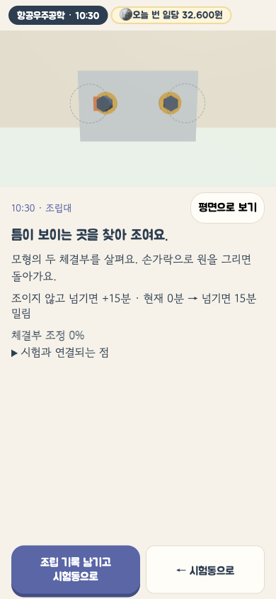
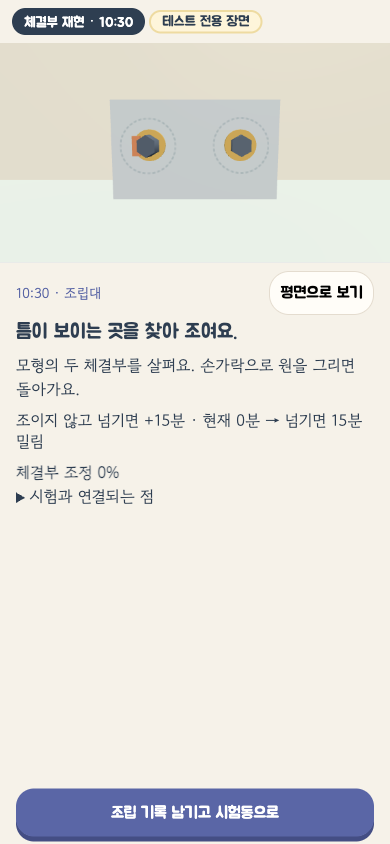
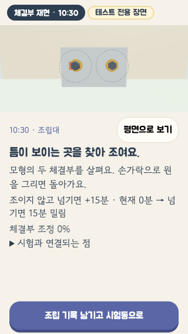
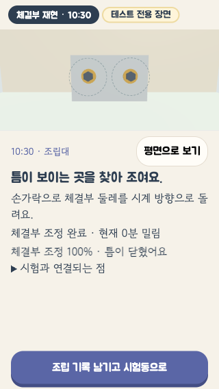
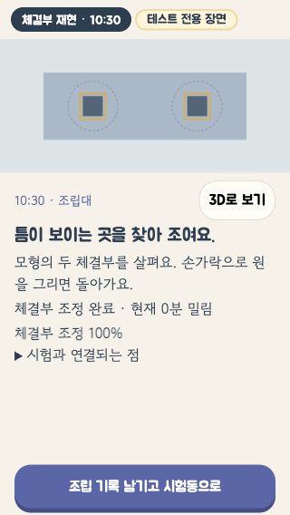
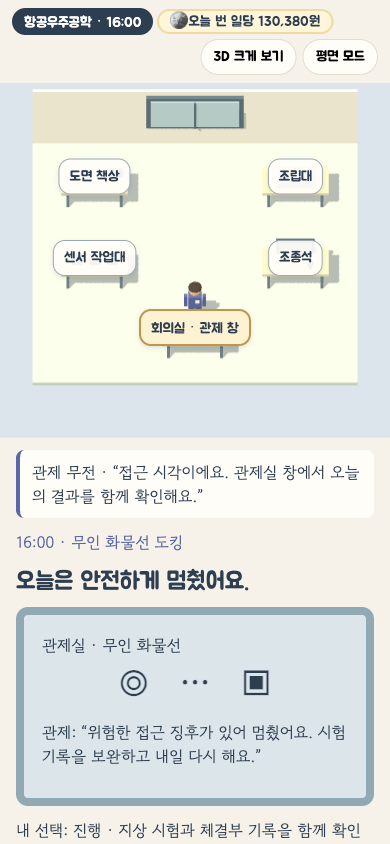
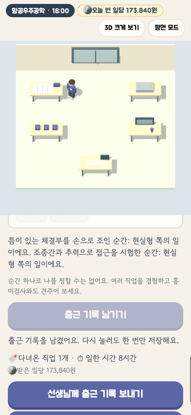
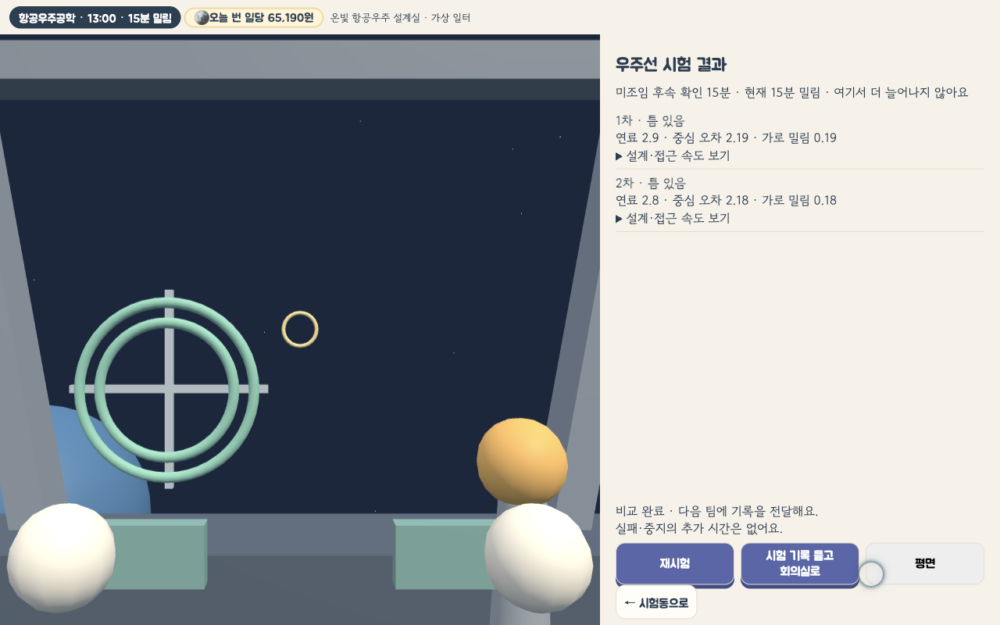
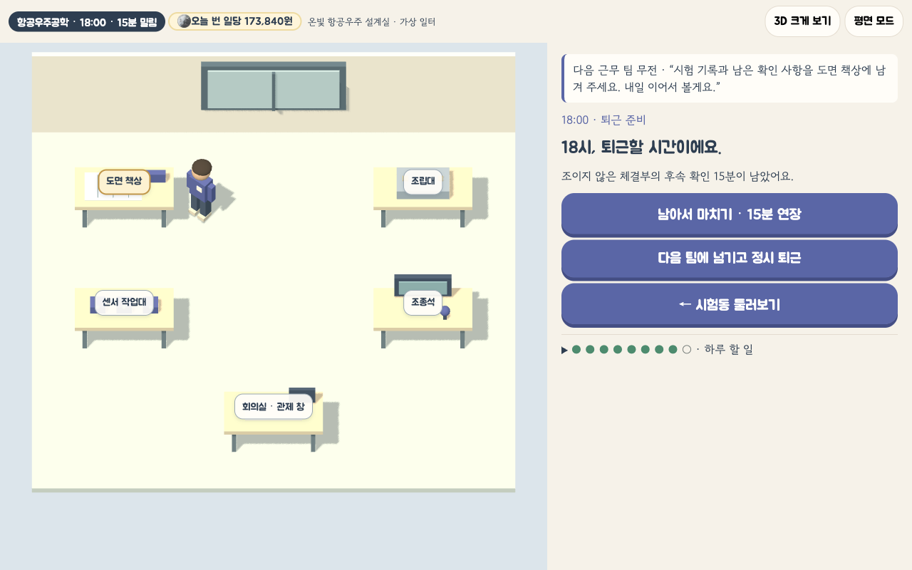
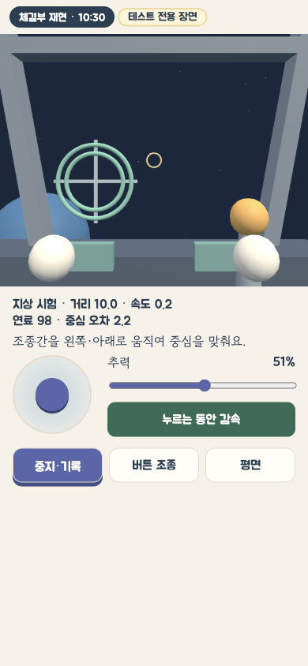

# 조립대부터 직접 검증 (2026-11-20)

## 발견하고 고친 문제

작업 화면 크기가 바뀔 때 3D 카메라와 HTML 터치 표적의 갱신 순서가 달라 볼트와 점선 원이 어긋났습니다. 작업 화면 ResizeObserver에서 카메라 크기 → 3D 그리기 → 표적 위치를 함께 갱신하도록 고쳤습니다. 해제 때 관찰자도 정리합니다.

| 수정 전 390×844 | 수정 후 390×844 |
|---|---|
|  |  |

수정 후 사진은 새 코드의 조립 단계만 여는 로컬 재현 화면입니다. 조임 상태는 주입하지 않고 0%에서 시작했습니다.

## 작은 SE와 평면 왕복

| SE 시작 | 직접 한 바퀴 조임 | 평면 전환 |
|---|---|---|
|  |  |  |

화면에 보이는 볼트 둘레를 포인터를 누른 채 한 바퀴 돌렸습니다. 평면으로 바꾸고 다시 3D로 돌아와도 100%와 0분 밀림이 유지됐습니다. 게임 상태를 강제로 완료하거나 3D 내부 좌표를 계산해 입력하지 않았습니다.

## 폰 하루 전체

명찰 → 장비 세 개 집어 놓기 → 도면 책상 → 조립대 직접 조임 → 센서 → 점심 → 조종석에서 설정을 바꾼 시험 → 판단 → 관제 결과 → 정리 → 퇴근 → 돌아보기 카드 → 기록 저장을 진행했습니다. 조종 시험은 조종간 포인터 이동과 추력 레버/키보드 입력으로 확인했습니다. 탭 전환 때의 자동 일시 정지와 재개도 확인했습니다.

| 진행을 골라도 위험하면 멈춤 | 퇴근 후 기록 저장 |
|---|---|
|  |  |

시작부터 조립까지는 기존 2f47458 앱에서 진행했고, 새 표적 보정은 별도 재현 화면과 PC 흐름으로 검증했습니다. 폰에서 무인 화물선 성공 도킹을 직접 달성했다는 뜻은 아닙니다. 성공/보류/중지의 분기와 일당·저장은 모델 검사로도 확인합니다.

## 영상의 범위

[SE 직접 조임 캔버스 영상](assembly-canvas.webm): 5.6초. `shared/tools/flicker.cjs` 결과 최대 초당 깜박임 0, 흰 프레임 0. 작업 캔버스만 녹화했으므로 전체 UI·하루 전체의 새 영상이나 A7 전체 프레임 독립 검토를 대신하지 않습니다.

## PC · 동작 줄이기 전체 하루

1280×800, `prefers-reduced-motion: reduce`에서 준비부터 퇴근·기록 저장까지 진행했습니다. 시험동 평면↔3D 왕복 후 이동도 이어졌습니다. 체결부를 조금만 돌려 미조임 상태로 넘기고 설정을 바꿔 두 번 시험했습니다. 15시에는 보류, 18시에는 정시 인계를 골랐습니다. 15분은 중복 가산되지 않았고 기본 일당 173,840원이 저장됐습니다. 폰 기록과 합쳐 16시간·347,680원이 보였습니다.

| 미조임 시험 결과와 15분 안내 | 18시 인계 선택 |
|---|---|
|  |  |

## 휴대폰 터치만으로 조종

별도 조종석 재현 화면에서 실제 터치 입력(`touchStart`/`touchMove`/`touchEnd`)으로 레버를 끌어 추력 51%를 만들고, 조종간을 끌고, 감속 버튼을 누른 채 유지했습니다. 키보드나 게임 상태 변경을 사용하지 않았습니다. 거리 12→10.4, 연료 100→98, 감속 중 속도 1.0→0.3을 확인했습니다.

[터치 조종 캔버스 영상](touch-flight-canvas.webm): 13.5초, 최대 초당 깜박임 0, 흰 프레임 0. 재현용 장면이므로 상단의 테스트 명찰은 실제 하루 시각을 나타내지 않습니다.
