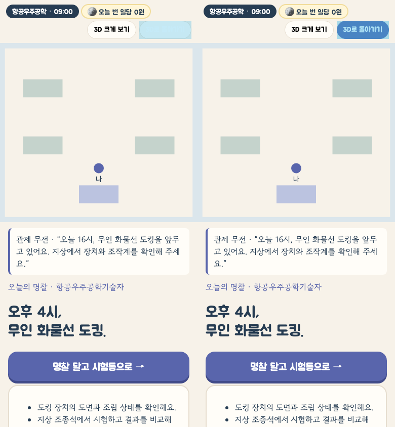

# 1-1 평면 모드 버튼

왼쪽 64c6654, 오른쪽 1-1 수정. 390×844 실제 터치 후 같은 장면입니다. 터치 강조 표시가 남아 있지만 실제 계산된 배경은 #5965ac, 글씨는 #fff입니다.

구현 2e76b91. 폰·SE·PC(동작 줄이기)·320px 평면에서 실제 입력으로 하루를 완료·저장했습니다. 오류·가로 밀림 0, 전체 UI 영상 깜박임 최대 초당 2 이하·흰 프레임 0입니다. PC는 초기 중단 영상과 리소스 오류가 있던 재시도 대신 최종 깨끗한 재실행 결과만 첨부합니다.
