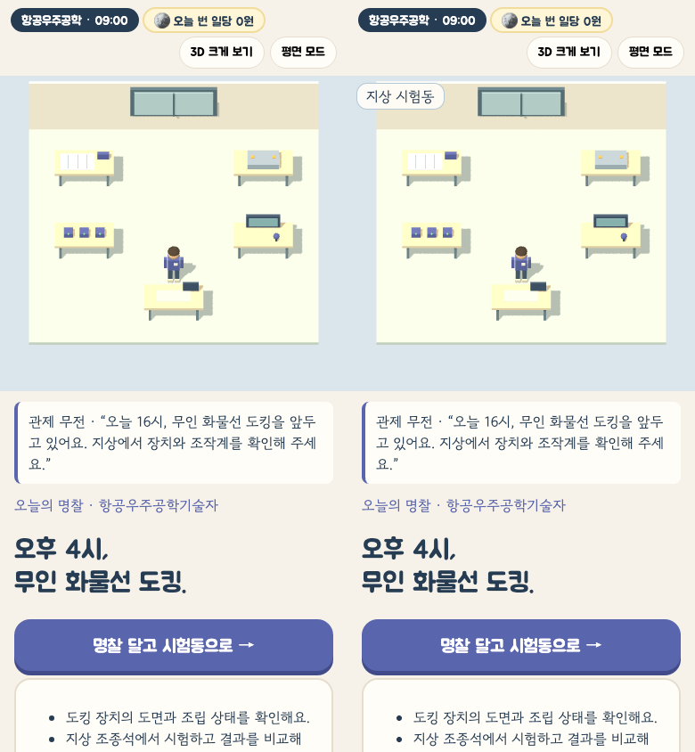
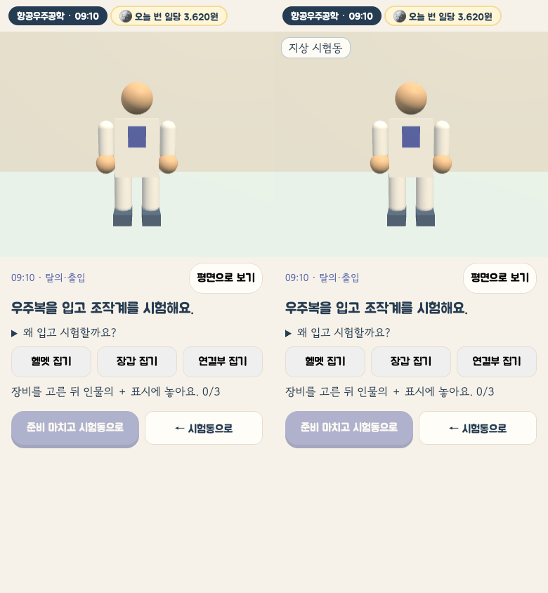
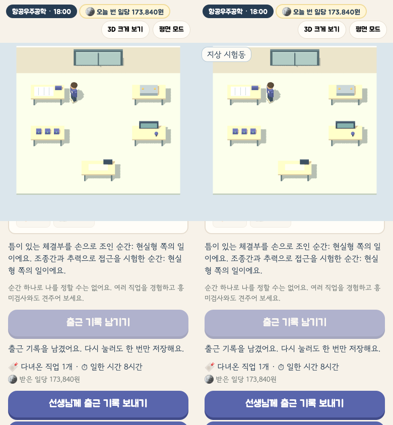

# 1-2 지상 시험동 표시

왼쪽 2e76b91, 오른쪽 32003d6. 같은 390×844 하루의 명찰·준비·저장 화면입니다.

폰·SE·PC(동작 줄이기)·320px 평면 하루를 실제 입력으로 끝내고 저장했습니다. 모든 촬영 시점에서 지상 시험동 표시가 보임을 확인했습니다. 영상 검사 결과는 flicker.txt, 각 환경의 시각·오류 기록은 JSON입니다.
