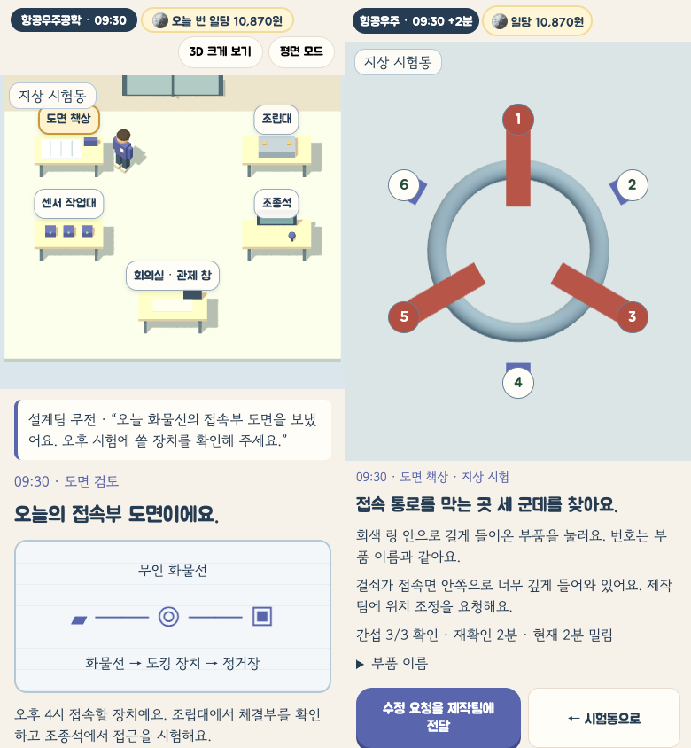

# 3-1 전후 비교

d79364d의 도면 간섭 찾기. 왼쪽은 도입 전 8911936의 자리 표시, 오른쪽은 같은 기능과 자체 글꼴을 포함한 c2691fd에서 세 곳을 직접 찾은 화면입니다. 중간 d79364d의 외부 글꼴 연결 실패는 그 판 전체 통과로 표시하지 않습니다. 최신 전체 흐름 검증을 함께 확인해 주세요.

[최종 전체 흐름 검증](../final-flow/README.md). 중간 판의 오류 기록은 아래 JSON에 그대로 보존합니다.
