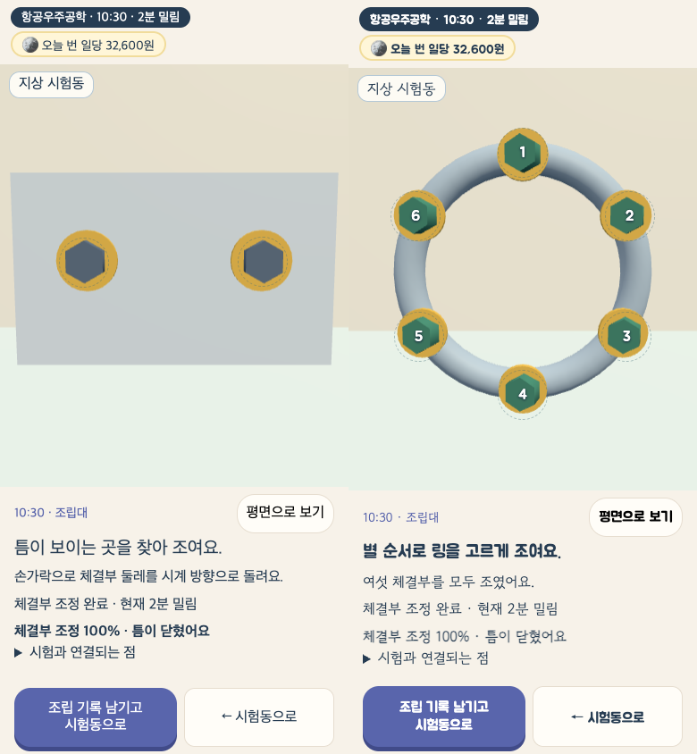

# 3-2 여섯 볼트 별 순서 조이기

구현 b032b23. 왼쪽 직전 항목 판, 오른쪽 이 항목 판. 폰 390×844의 같은 작업 자리를 비교합니다.

폰·SE·PC(동작 줄이기)·320px 평면에서 실제 터치/마우스로 하루를 완료하고 저장했습니다. 오류·가로 밀림 0. 전체 UI 영상 검사 결과는 flicker.txt, 각 환경의 시각·오류는 JSON입니다. 정지 사진은 실제 뷰포트 크기, 영상은 전체 화면을 축소해 기록합니다.

왼쪽 3-1 촬영 때 외부 글꼴 요청이 실패해 대체 글꼴이 보입니다. 이 사진은 조립 장치 변화 비교이며 글꼴 변경의 근거가 아닙니다. 최신 c2691fd는 같은 공통 글꼴을 자체 포함해 이 연결 의존성을 없앴습니다.
