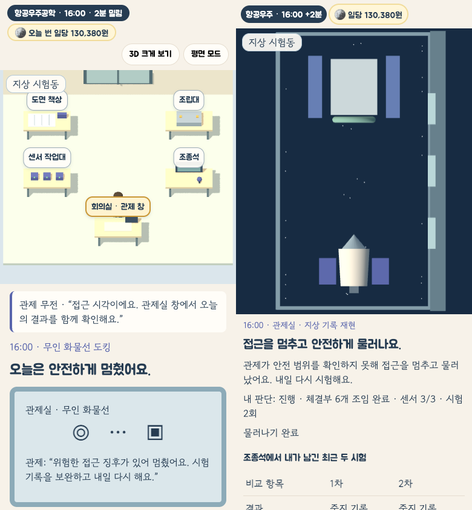

# 3-4 관제실 화물선 접근과 안전 중지

구현 7d22a3e. 왼쪽 직전 항목 판, 오른쪽은 이 기능에 폰 세로 배치를 보완한 5c04a09 판입니다. 폰 390×844의 같은 작업 자리를 비교합니다.

폰·SE·PC(동작 줄이기)·320px 평면에서 실제 터치/마우스로 하루를 완료하고 저장했습니다. 오류·가로 밀림 0. 전체 UI 영상 검사 결과는 flicker.txt, 각 환경의 시각·오류는 JSON입니다. 정지 사진은 실제 뷰포트 크기, 영상은 전체 화면을 축소해 기록합니다.

항목별 JSON·영상은 7d22a3e 고정 판, 사진 오른쪽은 이후 a242812·5c04a09 배치 보완까지 포함합니다. 두 화면 모두 관제 안전 중지 경로입니다.
