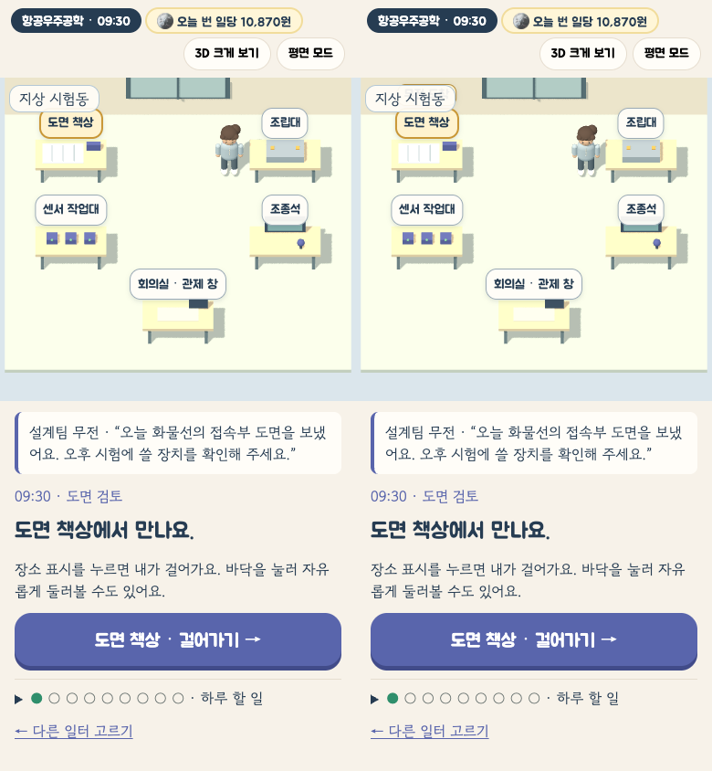

# 4-2 3D 작업 자리의 무전 표시

구현 58fc6f2. 왼쪽 직전 항목 판, 오른쪽 이 항목 판. 폰 390×844의 같은 작업 자리를 비교합니다.

폰·SE·PC(동작 줄이기)·320px 평면에서 실제 터치/마우스로 하루를 완료하고 저장했습니다. 오류·가로 밀림 0. 전체 UI 영상 검사 결과는 flicker.txt, 각 환경의 시각·오류는 JSON입니다. 정지 사진은 실제 뷰포트 크기, 영상은 전체 화면을 축소해 기록합니다.

이 항목의 초기 사진에서는 작은 폰 무전 표시가 잘렸습니다. 최종 5c04a09에서 위치를 보완했고, [SE 전후와 최종 전체 검사](../final-flow/README.md)를 확인해 주세요. 초기 사진을 최종 표시의 증거로 쓰지 않습니다.
