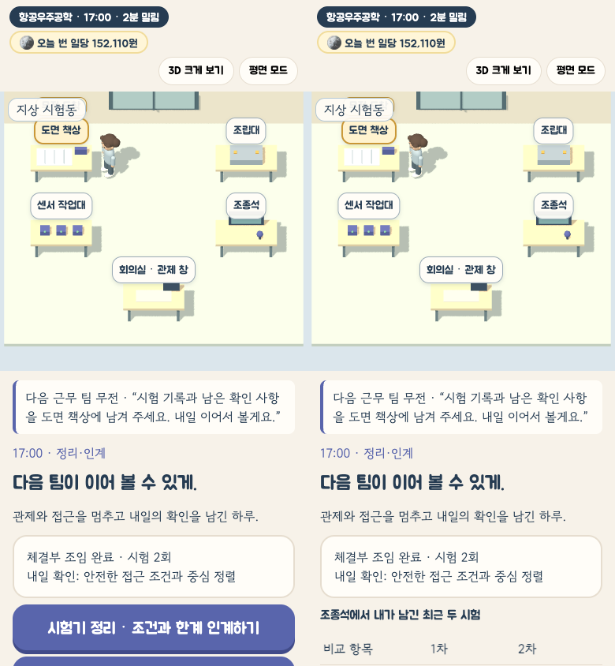
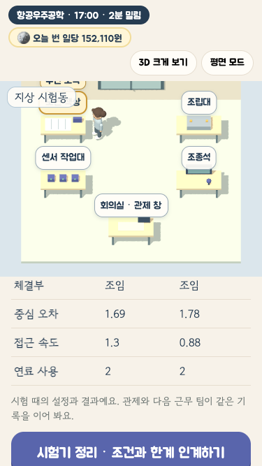
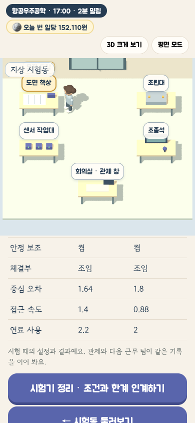

# 4-3 실제 시험 결과가 이어지는 보고

구현 ce0e54b. 왼쪽 직전 항목 판, 오른쪽 이 항목 판. 폰 390×844의 같은 작업 자리를 비교합니다.

폰·SE·PC(동작 줄이기)·320px 평면에서 실제 터치/마우스로 하루를 완료하고 저장했습니다. 오류·가로 밀림 0. 전체 UI 영상 검사 결과는 flicker.txt, 각 환경의 시각·오류는 JSON입니다. 정지 사진은 실제 뷰포트 크기, 영상은 전체 화면을 축소해 기록합니다.

시험 직후 화면에 보인 두 기록의 질량·중심 오차·접근 속도·연료 값을 읽고, 15시·16시·17시 보고 표의 실제 표시 값과 일치하는지 네 환경에서 확인했습니다.

