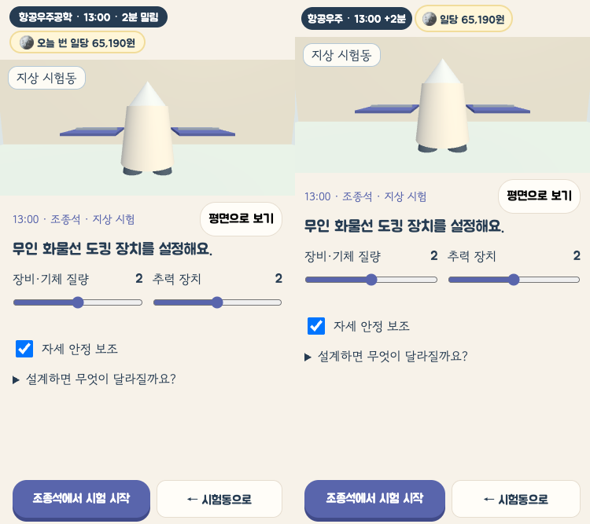
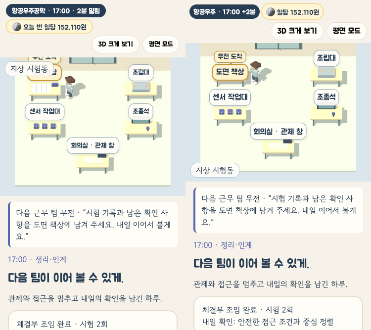

# 4-4 작은 폰 배치

구현 6f8d716, 후속 무전 위치 5c04a09. 왼쪽 4-3 고정 판(ce0e54b), 오른쪽 최신 자체 글꼴 판(c2691fd). 같은 SE 375×667에서 실제 터치로 하루를 진행한 설계와 보고 장면입니다.

단일 HUD와 정상 문서 흐름으로 버튼이 조작 요소를 덮지 않게 했습니다. 320×568 평면을 포함한 네 환경의 전체 조작·저장, 가로 밀림 0, 오류 0, 영상 검사 통과는 [최종 전체 결과](../final-flow/README.md)에 있습니다. 비교는 초기 배치뿐 아니라 이후 무전·자체 글꼴 보완까지 포함합니다.
