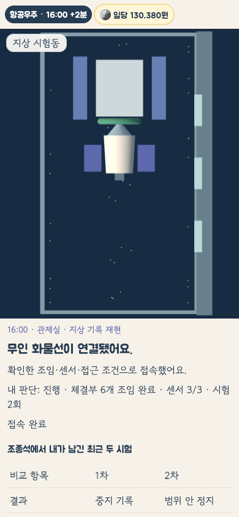
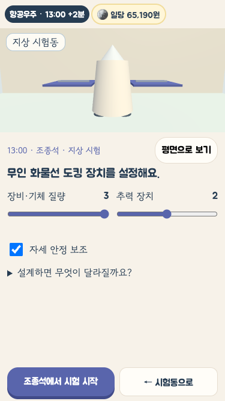
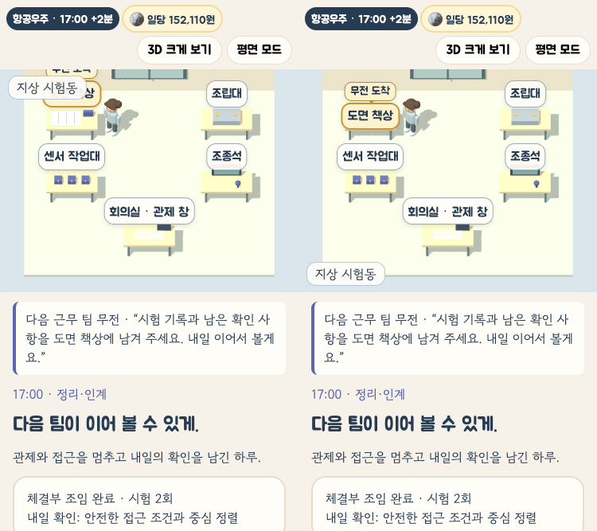

# 전체 흐름 검증

폰·SE·PC(동작 줄이기)·320px 평면에서 실제 입력으로 하루 완료·저장, 오류·가로 밀림 0. final-matrix는 05e4e23 앱 묶음, radio-fit-matrix는 5c04a09 무전 표시 보완 판입니다. 두 묶음 모두 전체 UI 영상 깜박임 최대 초당 2 이하·흰 프레임 0. 영상은 전체 뷰포트를 축소해 기록하고 사진은 원래 해상도로 남깁니다.

## 직접 도킹 성공

조종간으로 중심을 맞추고 추력을 조절해 접근했습니다. 16시 관제 재현에 연결 결과와 실제 두 시험 기록이 이어집니다. PC는 미조임·보류, SE/평면은 시험 중지 후 관제 안전 중지 경로입니다.

## SE 설계 조작

## SE 무전 표시 전후

왼쪽 잘림 발견, 오른쪽 5c04a09 수정.

c2691fd의 자체 글꼴 포함 판도 폰·SE·PC·320px 평면에서 다시 하루 전체 실제 조작·저장을 통과했습니다. 폰은 직접 성공 도킹, PC는 미조임·보류, SE/평면은 안전 중지 경로입니다. 전체 UI 영상 네 개도 최대 초당 2 이하·흰 프레임 0, 앱 오류·가로 밀림 0입니다. 결과는 local-font-final/에 있습니다.
