# 최종 판 · 실제 손 입력과 전후 비교

앱 소스 `cf09e70`, 브랜치 `codex/aerospace-story`. 왼쪽 기준판 `7ad76de`, 오른쪽 최종 판. 폰/SE 사진은 원래 뷰포트 크기입니다.

| 환경 | 확인 경로 | 오류·가로 밀림 | 전체 UI 영상 | 깜박임 최대/초 | 흰 프레임 |
| --- | --- | --- | --- | --- | --- |
| 폰 390×844 터치 | 실제 조종 성공 → 접속 → 저장 | 0 | 109.1초 | 1 | 0 |
| SE 375×667 터치 | 시험 중지 → 관제 안전 후퇴 → 저장 | 0 | 73.3초 | 1 | 0 |
| PC 1280×800 마우스·동작 줄이기 | 볼트·센서 직접 조작 → 보류 → 저장 | 0 | 75.0초 | 1 | 0 |
| 평면 320×568 터치 | 같은 전체 작업 → 안전 후퇴 → 저장 | 0 | 70.9초 | 3 | 0 |

네 영상 모두 공통 기준(초당 3 이하, 흰 프레임 0)을 통과했습니다. 실제 휴대폰 하드웨어가 아닌 브라우저 뷰포트의 CDP 터치입니다. 전체 뷰포트 영상은 폭 320px로 축소 기록했습니다. 원본 영상·동작별 사진은 로컬 `outputs/preflight-round/transition/`에 있으며, 저장소에는 비교 사진·입력 단계 JSON·영상 분석 결과를 남겼습니다. 각 항목의 독립 고정 판 결과는 상위 item-* 폴더입니다.

## 조립대와 도면

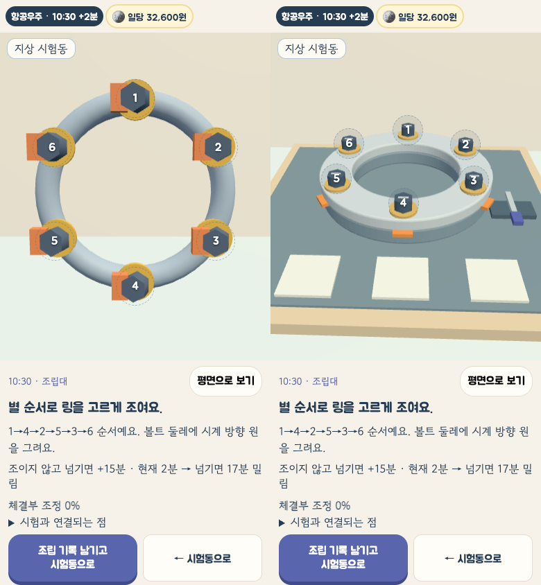
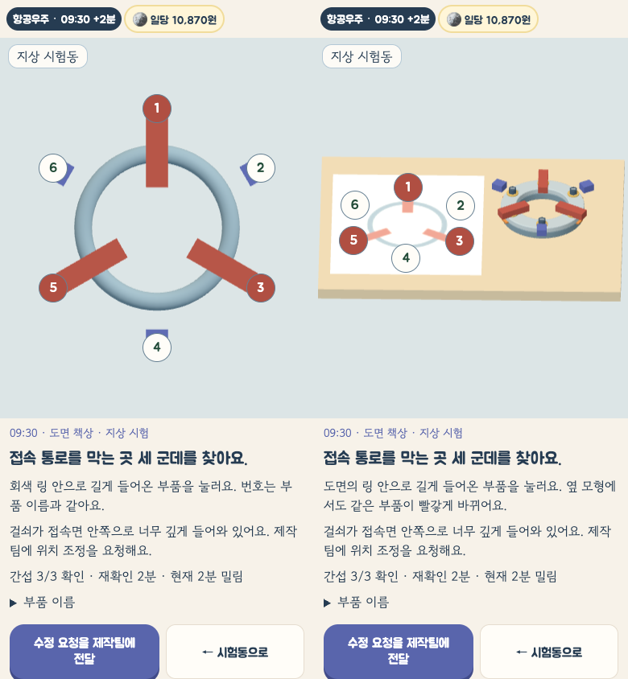
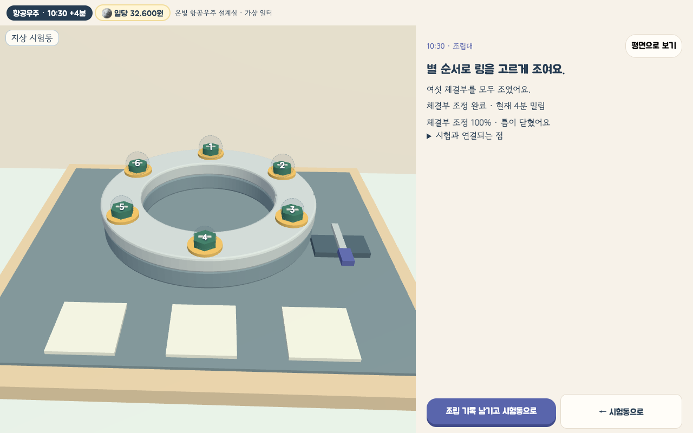

## 센서 집기와 놓기

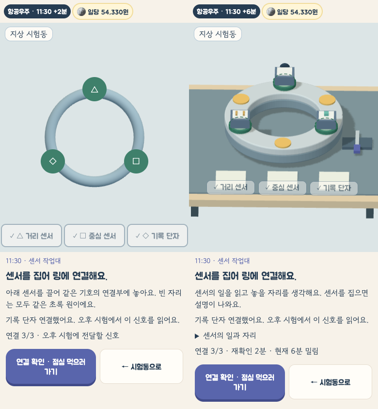
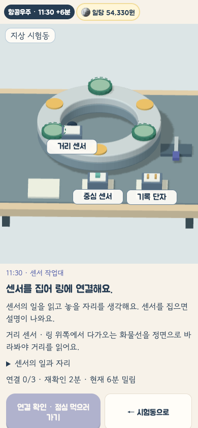
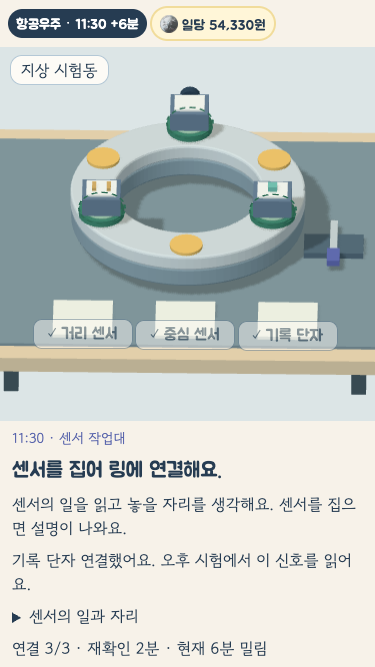

## 공간과 장소 표시

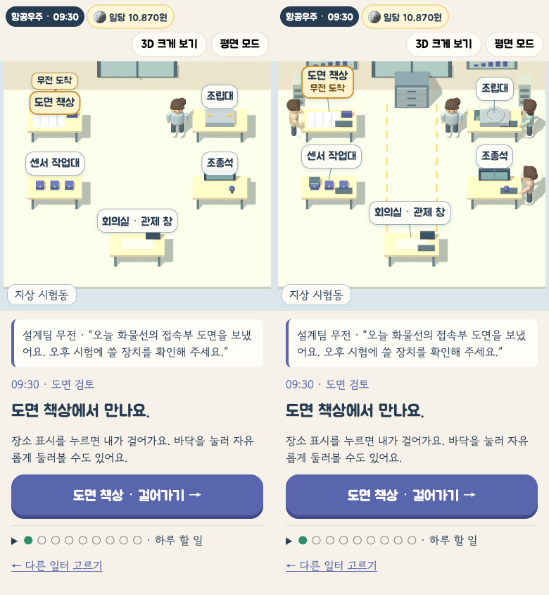
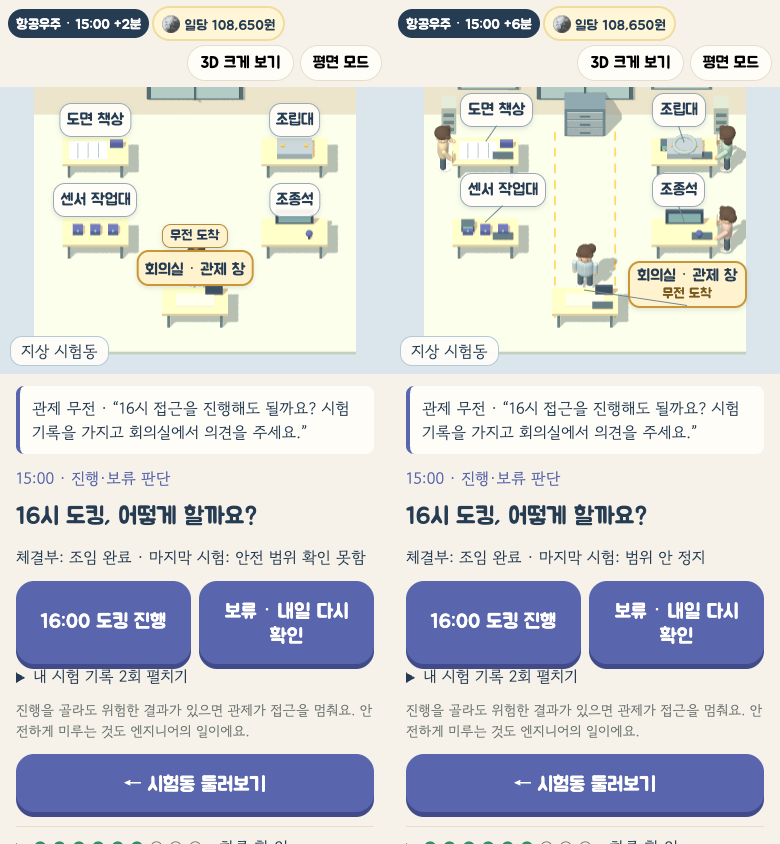

## 접근을 본 뒤 결과 확인

다음 비교는 두 판 모두 접근 중입니다. 왼쪽은 기준판 전체 영상의 52.00초 프레임(원본 320×692), 오른쪽은 최종 폰 사진을 같은 크기로 축소했습니다. 아직 접근 중인데 결과를 알리던 문장이 중립적인 관제 안내로 바뀌었습니다. 오른쪽은 성공 시험 경로, 왼쪽은 중지 시험 경로이므로 이후 결과 자체는 다릅니다.

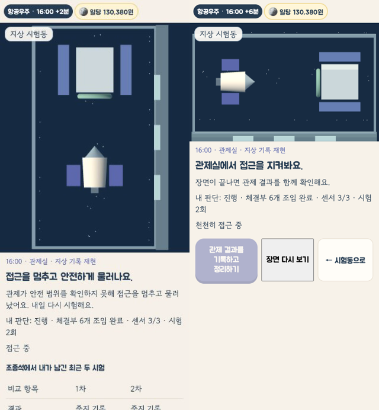
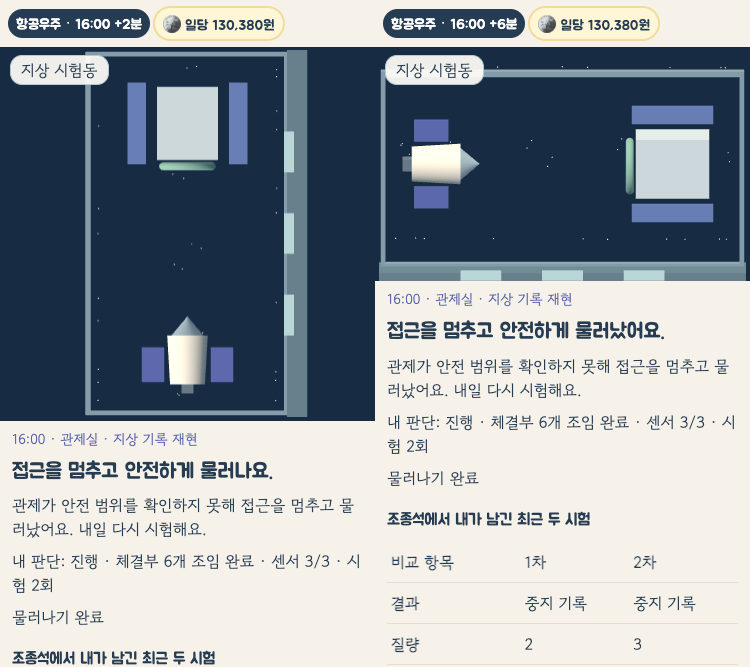
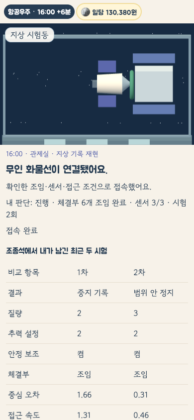
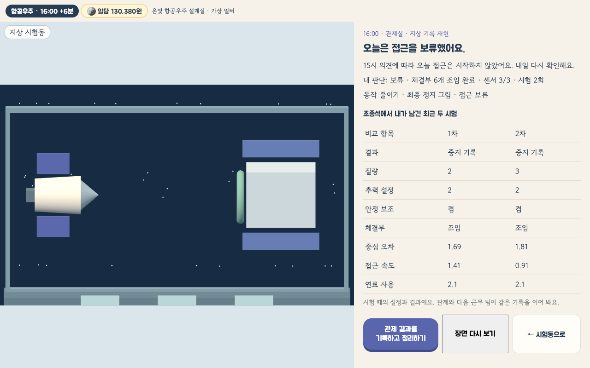

같은 볼트 순서 실수를 두 번 눌러도 시계가 한 번만 늘어나는 것을 직접 확인했습니다. 보고 표의 실제 질량·중심 오차·속도·연료 값이 15·16·17시에 일치함도 확인했습니다. 미조임·관제 중지 경로는 항목별 PC 고정 판에서 별도로 확인합니다.

## 추가 분기와 통합 회귀

- a41a3f3의 320px 실제 터치 추가 분기에서 남아서 마치기 → 18:06·연장 6분 명세서·저장까지 통과했습니다. `overtime.json`, `overtime-flicker.txt`(69.6초, 최대 2/초, 흰 프레임 0), `overtime-slip.png`. 명세서 사진의 첫 화면에는 금액이 보이며 연장 행은 DOM 검사로 확인했습니다.
- a41a3f3의 PC 추가 분기에서 볼트를 생략하고도 학생이 진행을 고르면 관제가 접근을 중지하는 것을 확인했습니다. `loose-go.json`, `loose-go-flicker.txt`(60.7초, 최대 1/초, 흰 프레임 0), `loose-go.png`. 이후 cf09e70까지의 변경은 전환 렌더링 수정입니다.
- 최종 소스 cf09e70과 통합 6b59988의 임시 결합 트리에서 공통·병원/소방서·카페·우주항공 검사, 생성 파일 65개 일치가 통과했습니다. `integration-checks.txt`, `integration-tree.txt`. 실제 브랜치 병합·배포는 없습니다.
- [영상에서 찾은 전환 빈 화면과 수정 전후](../resize/README.md). 흰 프레임 검사만으로 못 찾았던 문제도 별도로 보존했습니다.
