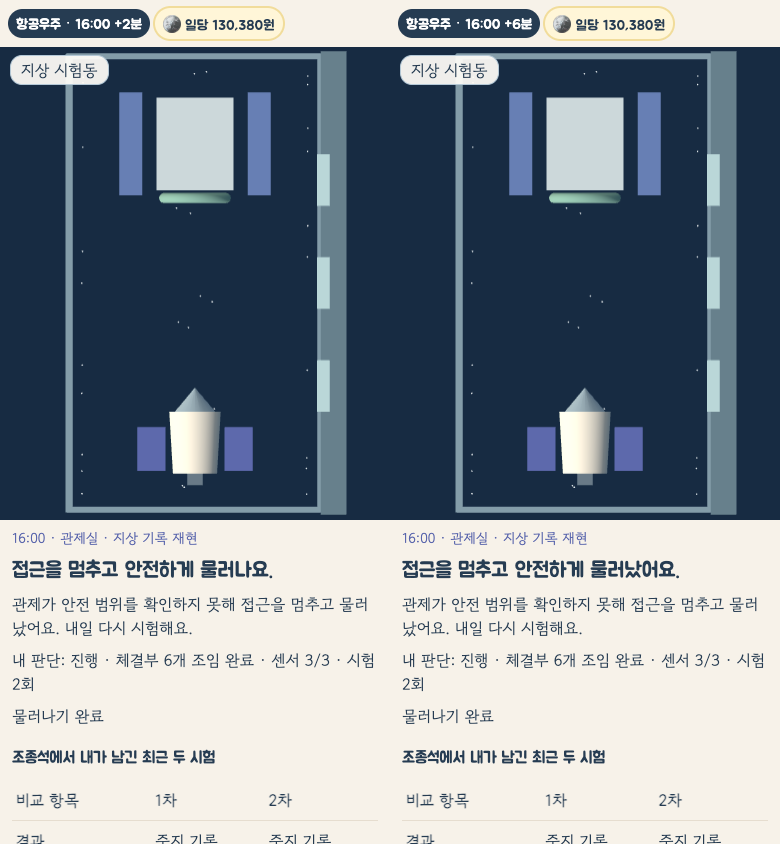
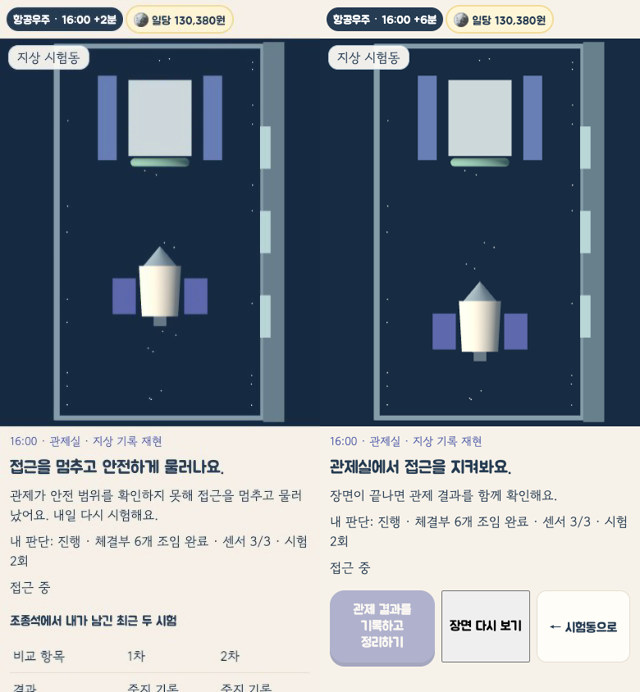

# 4. 영상 뒤 결과 공개

구현 `4698f08`. 왼쪽 기준판 7ad76de, 오른쪽 이 항목의 누적 수정판. 같은 폰 390×844 장면이며 실제 터치로 진행했습니다.

폰·SE·PC 동작 줄이기·320px 평면의 하루 전체를 실제 입력으로 완료하고 저장했습니다. 앱 오류·가로 밀림 0, 전체 UI 영상 네 개의 공통 깜박임 검사 통과·흰 프레임 0. 실제 휴대폰 하드웨어가 아니라 브라우저 뷰포트의 CDP 터치이며 PC는 마우스입니다. 게임 상태 주입과 3D 객체 좌표 조회는 하지 않았습니다. 사진은 원래 해상도, 영상은 전체 뷰포트를 320px 폭으로 축소 기록했습니다.

## 아직 접근 중일 때

왼쪽은 기준판 전체 영상 52.00초의 프레임, 오른쪽은 이 항목의 접근 중 사진을 같은 320×692로 축소한 것입니다. 두 판 모두 시험 중지 후 관제가 안전하게 물러나는 경로입니다. 접근 중에 미리 결과를 알리던 제목·보고를 장면 완료 뒤로 옮겼습니다. 진행 버튼도 그때 활성화됩니다. 동작 줄이기는 최종 정지 결과를 즉시 보여 줍니다.

