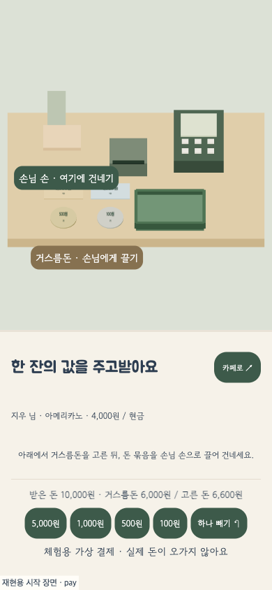
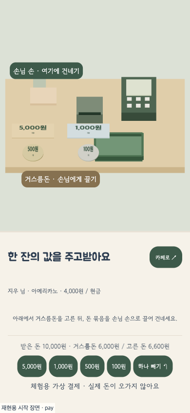
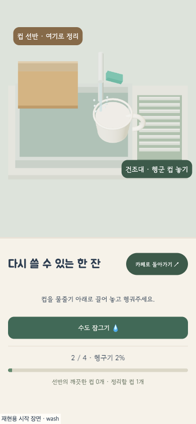
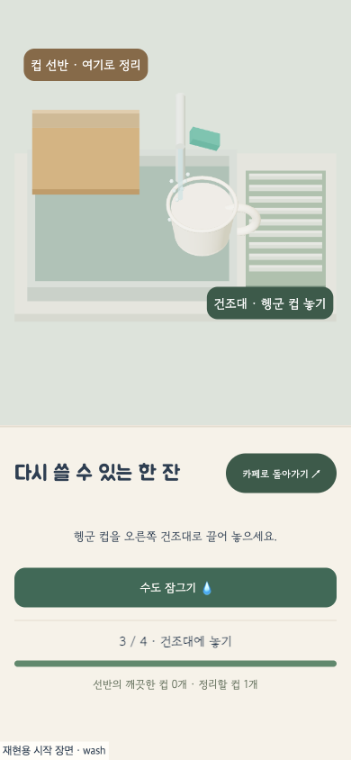
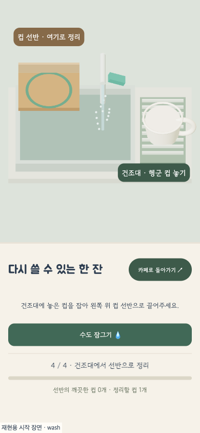
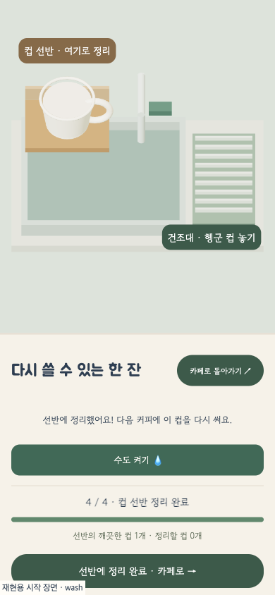
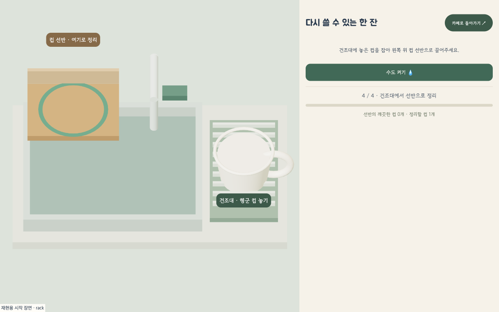
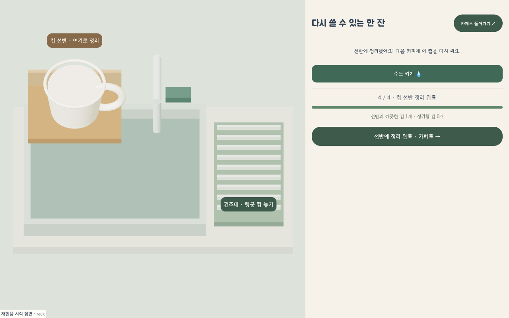

# 카페 직접 조작 · 전후 비교 (2026-11-20)

수정 전 `c5e305e`, 수정 후 `2f47458`. 둘 다 로컬 복사본이며 운영에는 반영하지 않았습니다. 같은 390×844 화면과 같은 재현용 시작 장면을 사용했습니다. 재현 도우미는 주문/세척 시작 상태만 만듭니다. 돈 받기·거스름돈 전달·수도 탭·문지르기·컵 끌기·건조대·선반 완료는 실제 포인터 입력으로 진행했습니다. 3D 좌표를 계산하거나 게임 상태를 강제로 완료하지 않았습니다.

## 네 종류 거스름돈

| 수정 전 | 수정 후 |
|---|---|
|  |  |

같은 순서로 5,000·1,000·500·100원을 고른 모습입니다. 두 줄의 윗줄 가림이 사라졌고 지폐 금액이 커졌습니다. 이후 500·100원을 빼서 6,000원으로 맞추고 지폐 묶음을 손님 손까지 직접 끌어 건넸습니다. 영수증 출력 단계로 넘어갔습니다.

## 같은 컵 가장자리로 헹구기

| 수정 전 | 수정 후 |
|---|---|
|  |  |

3D 수도 손잡이를 눌러 물을 켜고, 보이는 얼룩을 지그재그로 문질러 지웠습니다. 두 판에서 같은 손잡이 위치를 잡아 같은 경로로 컵을 옮겼습니다. 전에는 이동 중 잠깐 오른 2%에서 멈췄고, 후에는 헹구기가 완료됐습니다. 건조대 안내도 오른쪽 여백 20px 안쪽으로 들어왔습니다.

## 놓인 컵 확인

| 건조대에 직접 놓기 | 선반에 다시 집어 놓기 |
|---|---|
|  |  |

깨끗한 컵 1개·정리할 컵 0개로 바뀌고 수도가 잠겼습니다. 컵이 선반 아래로 숨지 않습니다.

## 영상의 범위

[물줄기·선반 이동 캔버스 영상](wash-canvas.webm): 5.5초. `shared/tools/flicker.cjs` 결과 최대 초당 깜박임 0, 흰 프레임 0. 이 영상은 3D 캔버스의 해당 장면만 녹화했습니다. 전체 UI·카페 하루 전체의 새 녹화나 A7 전체 프레임 독립 채점을 대신하지 않습니다.

## PC 선반 놓기

1280×800·동작 줄이기에서 건조대에 준비된 컵을 직접 끌어 선반에 놓았습니다. 깨끗한 컵 1개/정리할 컵 0개가 됐고, 선반 위 컵이 가려지지 않았습니다. 이 경우는 건조대 시작 재현이며 PC 세척 전체 하루를 새로 진행했다는 뜻은 아닙니다.

| PC 건조대 | PC 직접 놓기 완료 |
|---|---|
|  |  |
