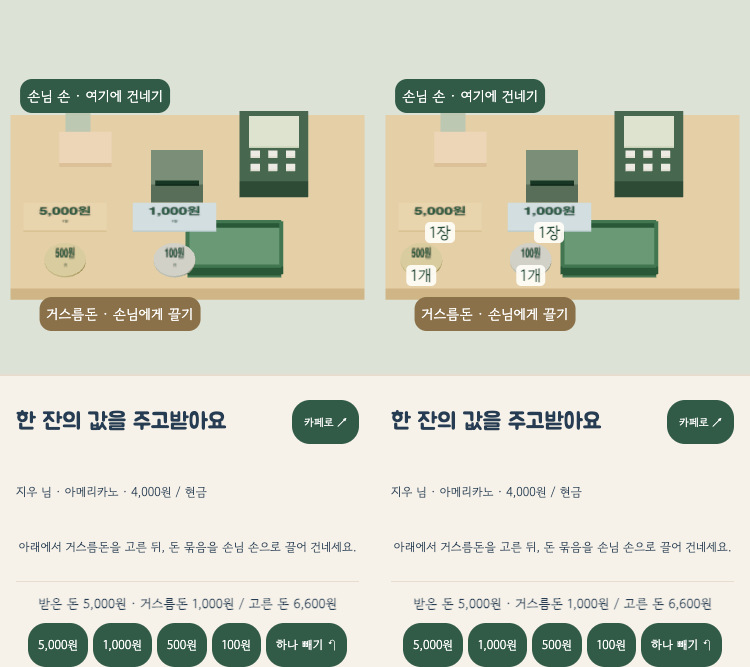

# 카페 작은 수정 · 전후 비교

왼쪽 기준판 64c6654, 오른쪽 수정판 05e4e23. 같은 SE 375×667 화면에서 실제 터치로 현금 받기·거스름돈 선택·컵 끌기를 수행했습니다.

기준판 하루 전체는 직접 진행해 세 손님 결제·제조·음용, 세 컵 수거·문지르기·헹구기·건조대·선반 재사용, 마감·돌아보기·기록 저장까지 확인했습니다. 기준판의 긴 대기 포함 영상은 인코딩을 중단했으므로 완주 영상/깜박임 통과 근거로 쓰지 않습니다. 수정판 SE·PC 전체 영상 검증은 진행 중입니다.
