# 카페 작은 수정 · 전후 비교와 전체 하루

비교 사진은 왼쪽 기준판 64c6654, 오른쪽 최종 수정판 238456f입니다. 같은 SE 375×667 또는 PC 1250×750에서 실제 터치/마우스로 조작했습니다. 게임 상태 주입이나 3D 객체 좌표 조회는 하지 않았습니다. 실제 휴대폰 하드웨어 검사는 아닙니다.

| 환경 | 전체 하루 | 앱 오류 / 입력 오류 | 전체 UI 영상 | 깜박임 최대/초 | 흰 프레임 |
| --- | --- | --- | --- | --- | --- |
| SE 터치 | 세 손님·세 컵·마감·저장 완료 | 0 / 0 | 475.8초 | 1 | 0 |
| PC 마우스 | 세 손님·세 컵·마감·저장 완료 | 0 / 0 | 472.5초 | 1 | 0 |

각 환경 118개 입력 명령, 동작별 사진 151장을 로컬 `outputs/story-batch/cafe-final-verified-{se,pc}`에 남겼습니다. `se-inputs.json`, `pc-inputs.json`에 재현 입력과 오류 기록이 있고, `*-flicker.txt`는 전체 뷰포트 영상 분석입니다. 영상은 320px 폭으로 축소 기록했고 사진은 원래 크기입니다. `tests/fixtures/manual-day-{se,pc}.json`으로 같은 입력을 재현할 수 있습니다.

## 동전과 장/개 표시

100원 동전을 서랍에서 떼고, 16px 장/개 표시가 다음 줄 및 거스름돈 안내와 겹치지 않게 했습니다. 1장/1개와 2장/2개 모두 조작하고 DOM 영역 분리도 확인했습니다.

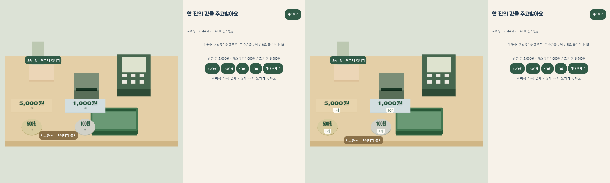
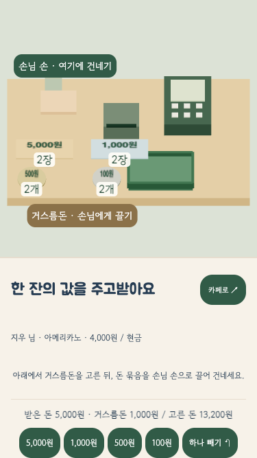
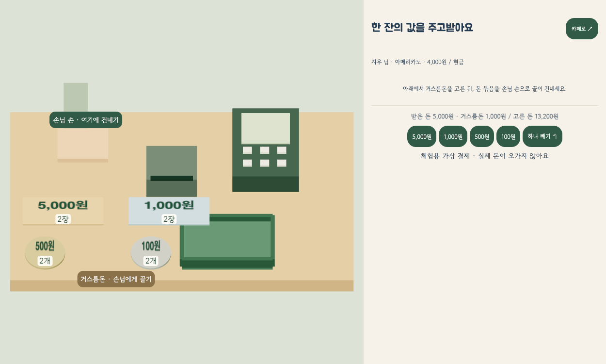

## 컵 놓기·붓기·헹구기·선반

컵 배치 후에도 계속 '컵을 놓아주세요'라고 하던 안내를 분쇄/추출 준비 안내로 고쳤습니다. 우유 피처 주둥이·물줄기·컵이 보이는 상태에서 직접 끌고, 수도를 누르고, 커피 자국을 문지르고, 헹군 컵을 건조대와 선반으로 옮겼습니다. 다음 손님에게 같은 컵을 다시 꺼내 썼습니다.

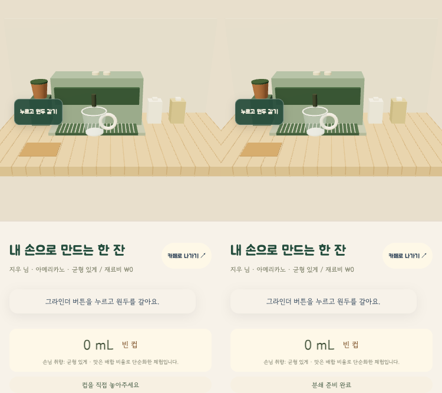
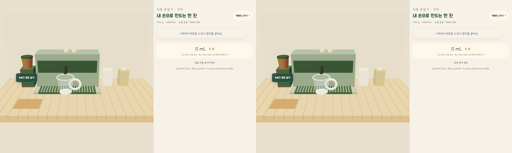
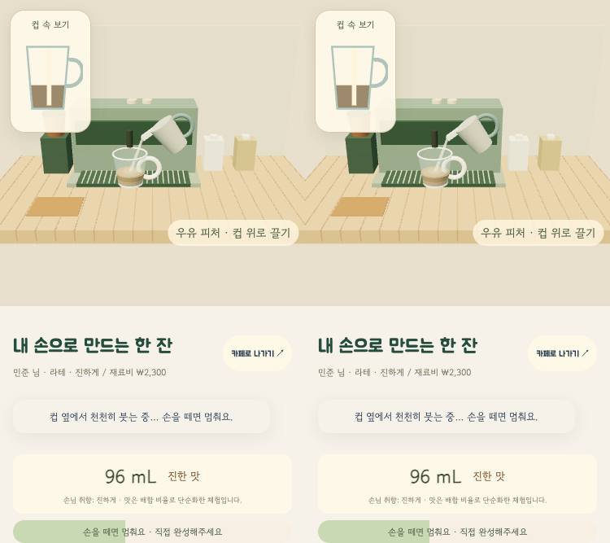
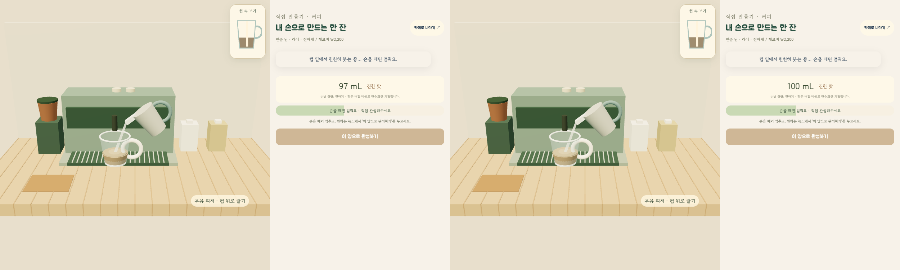
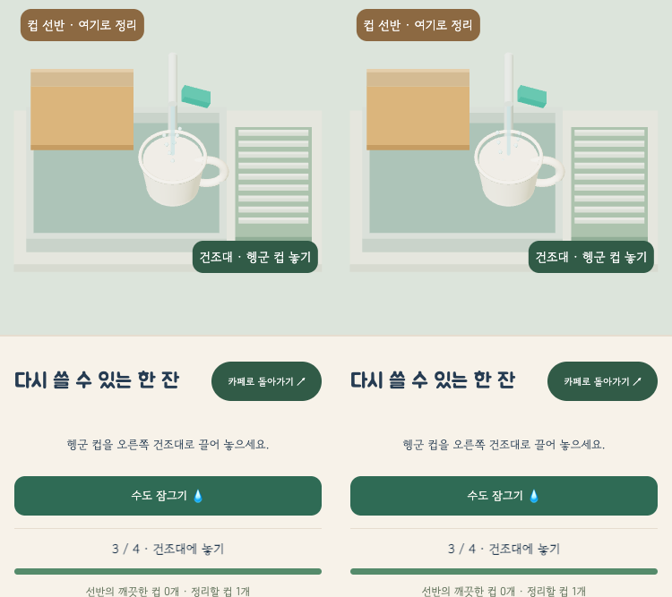
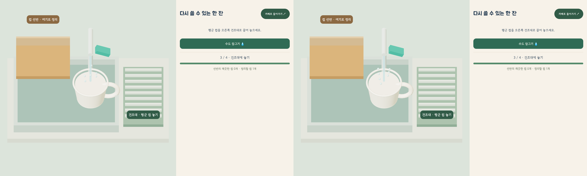
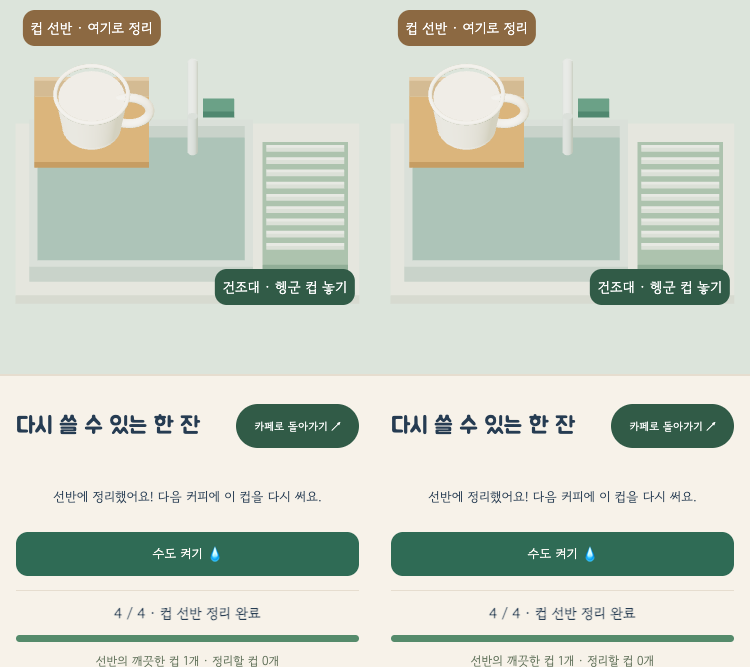
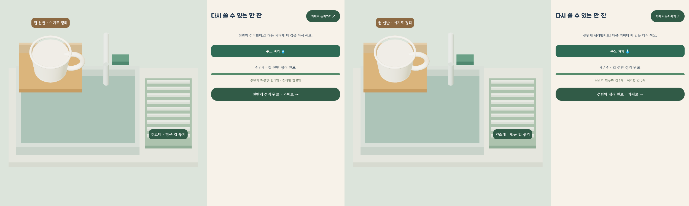

## 기준판과 중간 실행의 한계

기준판 SE는 세 손님부터 마감·저장까지 직접 완료했지만 대기가 긴 영상의 인코딩을 중단했으므로 그 영상은 완주/깜박임 통과 근거로 쓰지 않습니다. 기준판 PC와 일부 중간 수정판은 저장 후 중복된 마지막 명령 때문에 테스트 도구가 종료 오류를 냈습니다. 그 실행을 깨끗한 통과로 세지 않았고, 중복 명령을 제거한 최종 수정판의 SE·PC 전체 실행은 모두 종료 코드 0, 입력 오류 0입니다.
