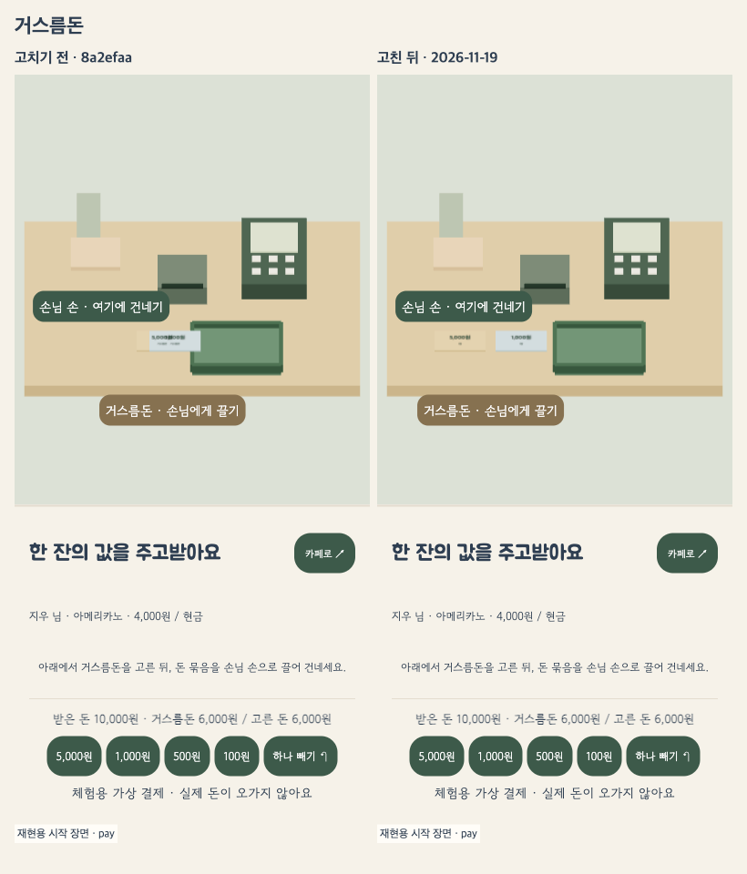
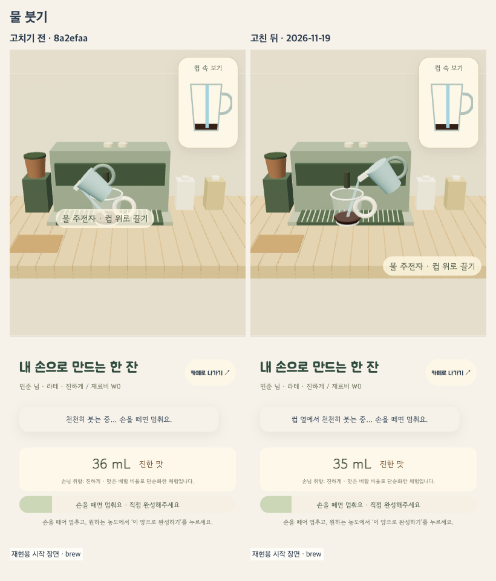
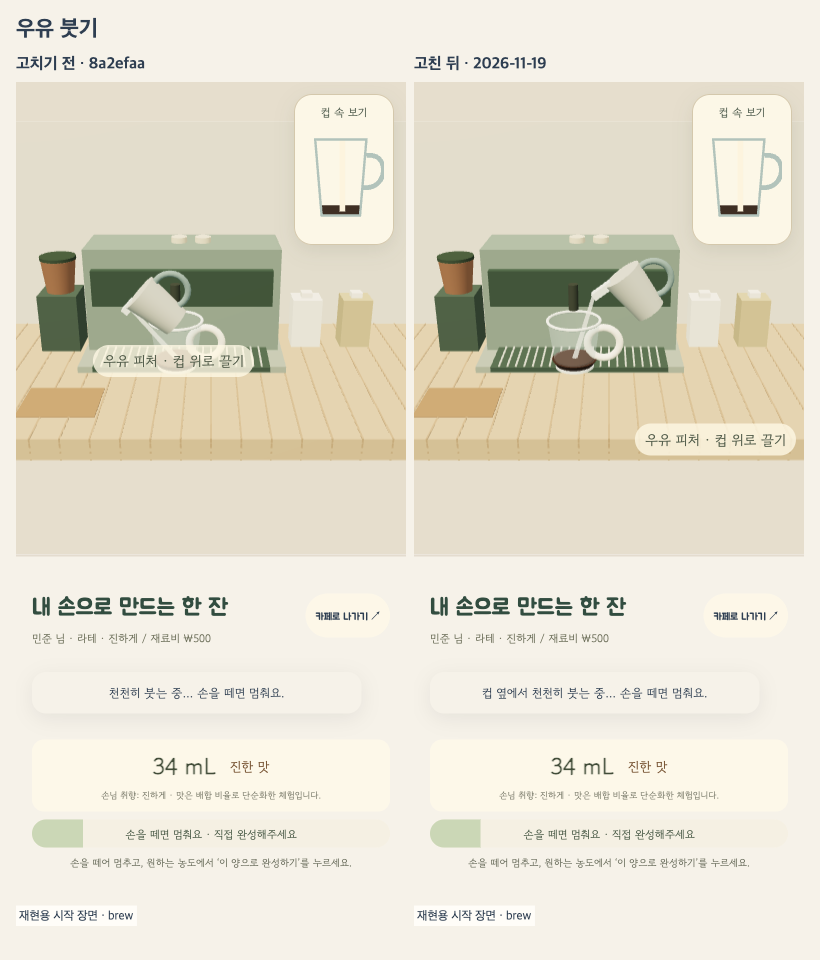
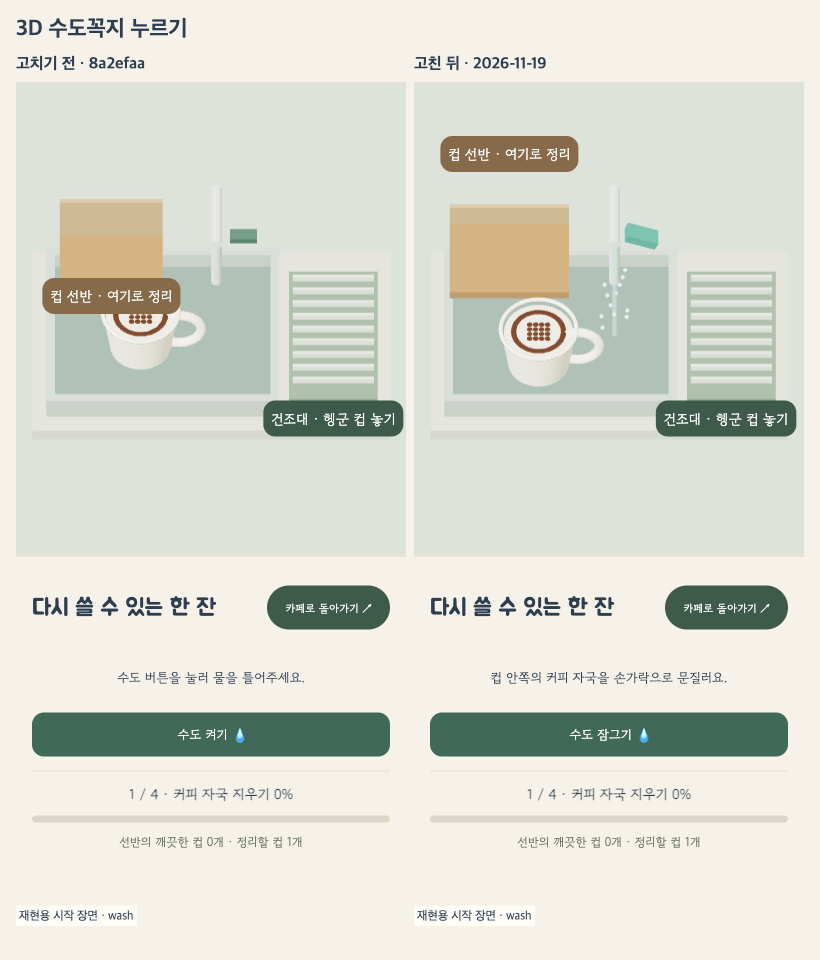
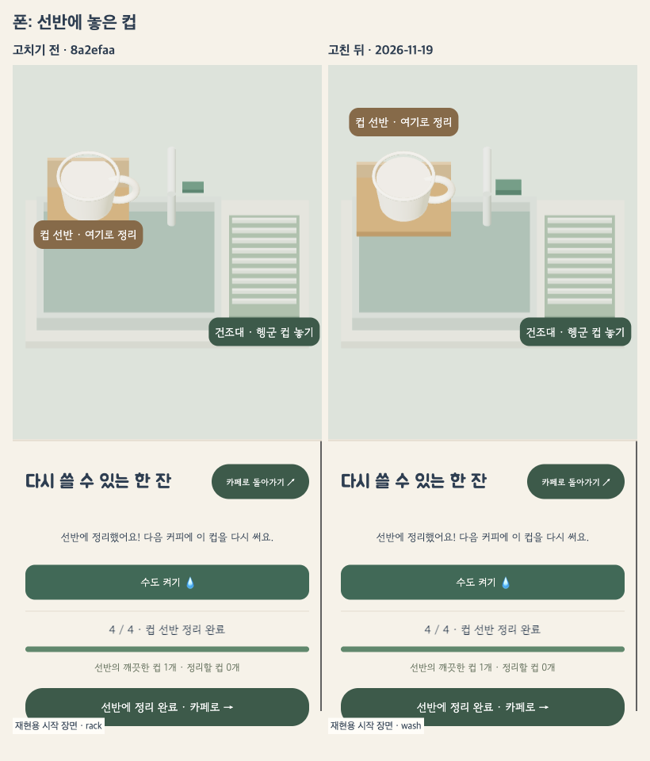
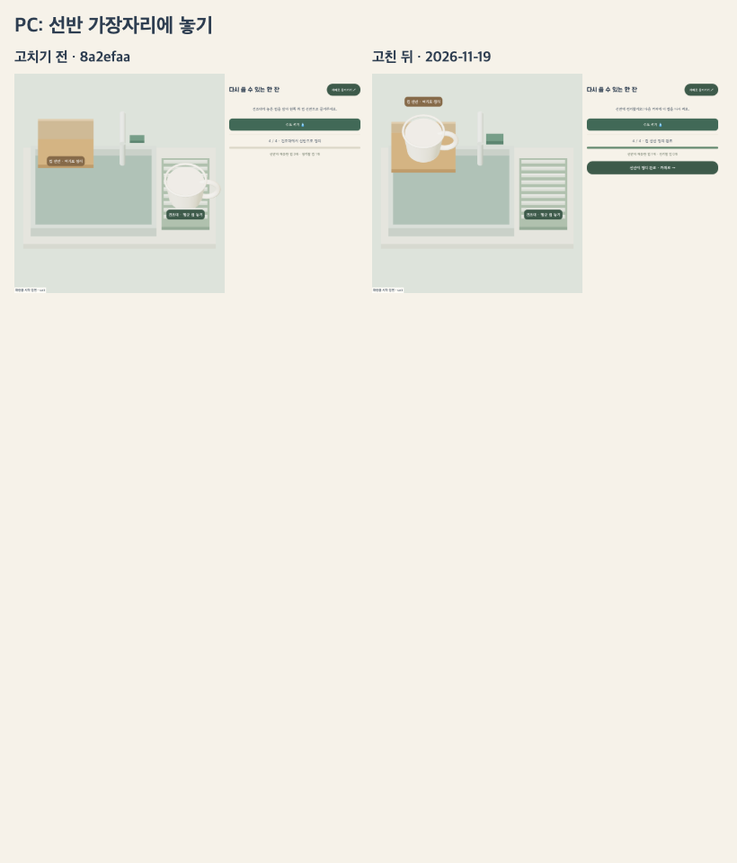
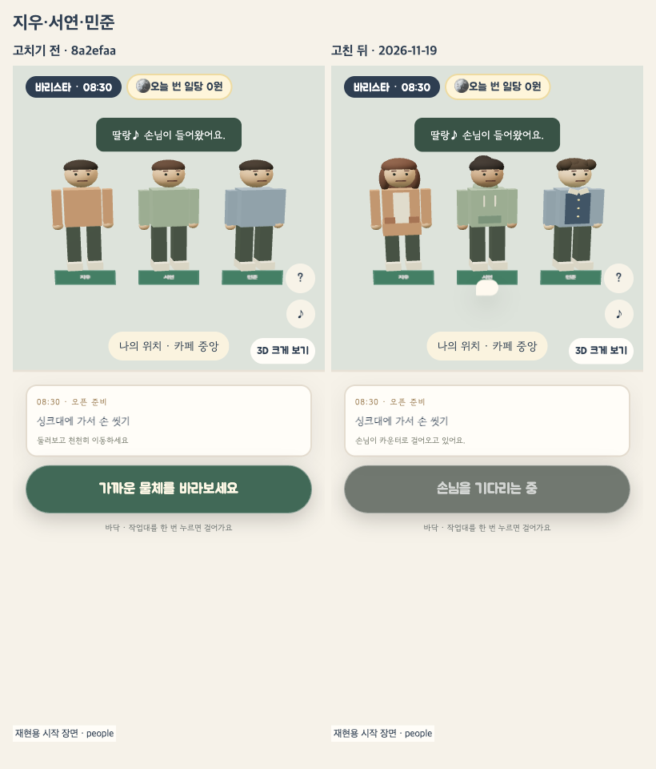

# 카페 손 조작 수정 · 전후 비교

기준 `8a2efaa`. 폰 크기 390×844 / PC 1280×800. 재현용 시작 장면을 준비한 뒤, 화면에서 물건을 보고 마우스 누르기→이동→놓기로 조작했습니다. 3D 내부 좌표 투영이나 앱 동작 함수 호출로 끌기를 대신하지 않았습니다. 실제 휴대전화 하드웨어 검사는 아닙니다.

[검증 범위와 다음 채점](VALIDATION.md)

## 거스름돈

[이전 원본](before-change.png) · [수정 원본](after-change.png)

## 물 붓기

[이전 원본](before-water-pour.png) · [수정 원본](after-water-pour.png)

## 우유 붓기

[이전 원본](before-milk-pour.png) · [수정 원본](after-milk-pour.png)

## 3D 수도꼭지 누르기

[이전 원본](before-tap.png) · [수정 원본](after-tap-on.png)

## 폰: 선반에 놓은 컵

[이전 원본](before-shelf-release.png) · [수정 원본](after-shelf-release.png)

## PC: 선반 가장자리에 놓기

[이전 원본](before-pc-edge-release.png) · [수정 원본](after-pc-edge-release.png)

## 지우·서연·민준

[이전 원본](before-people.png) · [수정 원본](after-people.png)

## 동작별 사진

- [after-tap-off](after-tap-off.png)
- [after-rub](after-rub.png)
- [after-rinse](after-rinse.png)
- [after-rack](after-rack.png)
- [after-shelf-drag](after-shelf-drag.png)
- [after-pc-edge-drag](after-pc-edge-drag.png)
- [before-pc-edge-drag](before-pc-edge-drag.png)
- [after-change-drag](after-change-drag.png)
- [after-water-release](after-water-release.png)
- [after-milk-release](after-milk-release.png)
