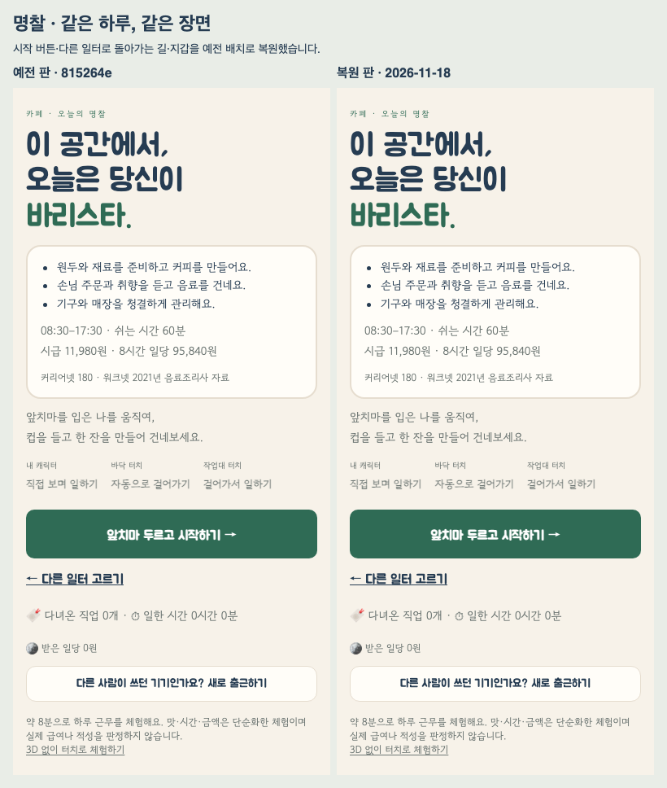
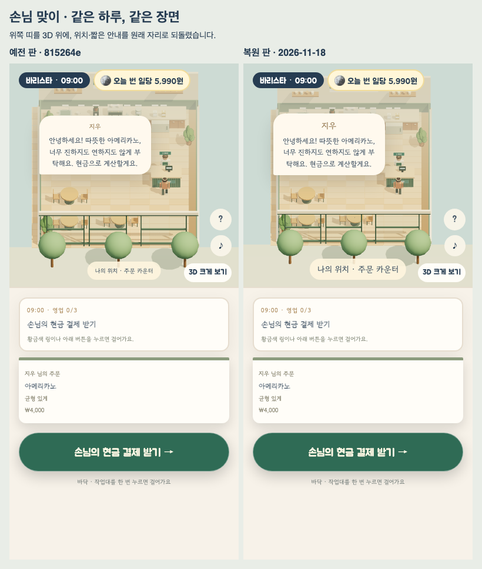
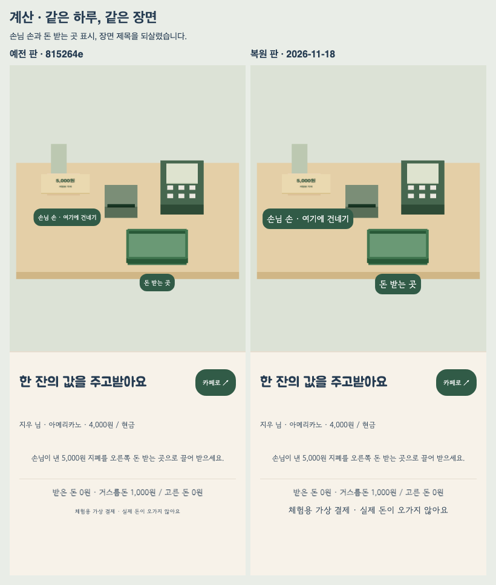
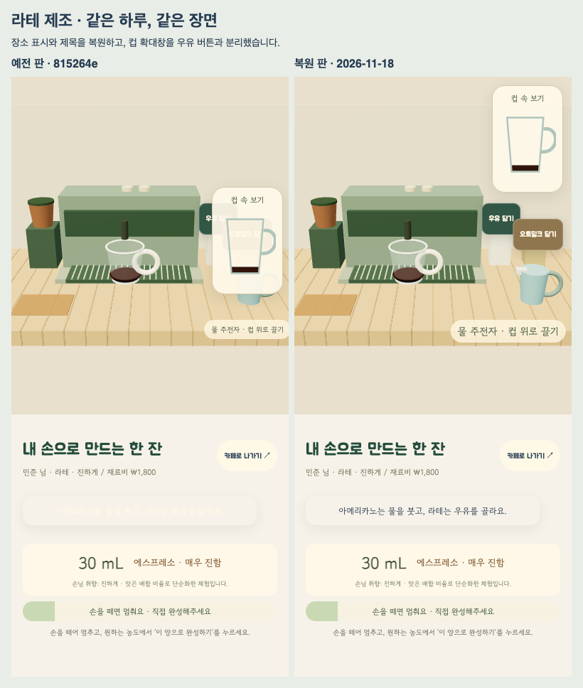
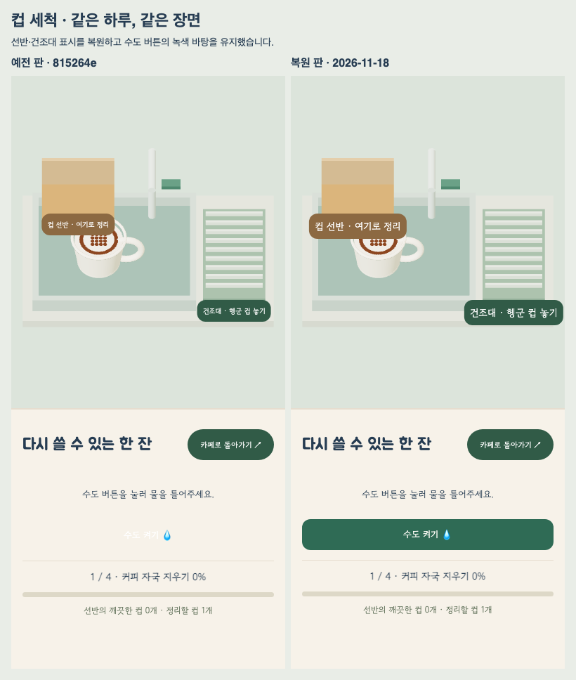
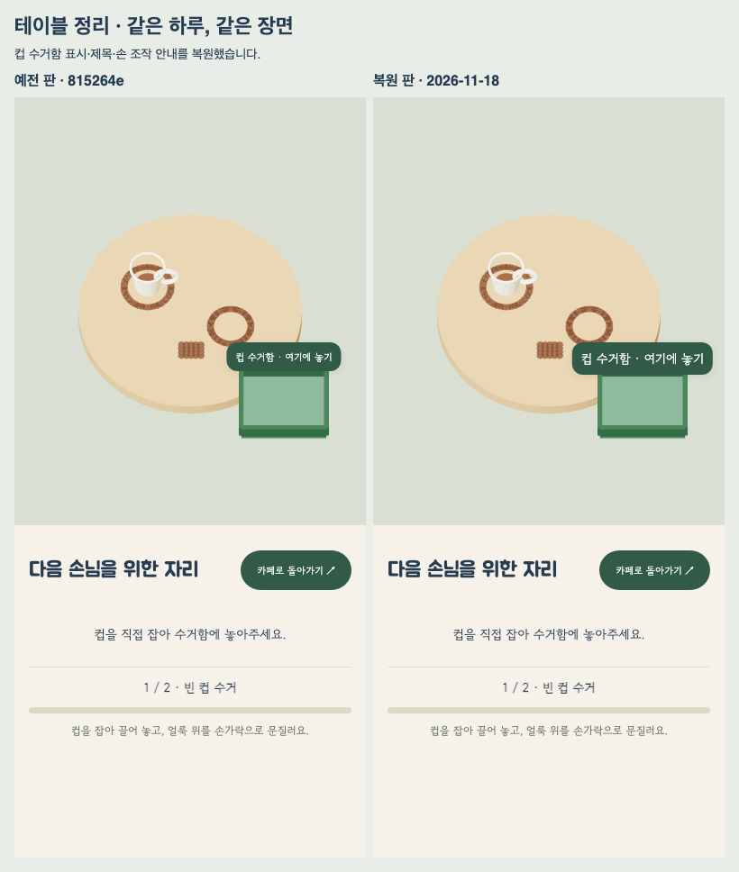
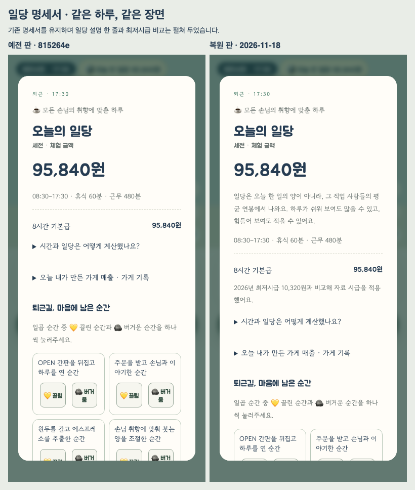

# 카페 복원 전후 비교

왼쪽: 815264e(11/16). 오른쪽: 복원 판. 두 판 모두 390×844에서 동일한 손님 세 명을 응대하고 컵을 다시 씻어 사용한 뒤 마감·기록 저장까지 진행했습니다. 장면 상태를 강제로 넘기지 않았습니다.

## 명찰

시작 버튼·다른 일터로 돌아가는 길·지갑을 예전 배치로 복원했습니다.

## 손님 맞이

위쪽 띠를 3D 위에, 위치·짧은 안내를 원래 자리로 되돌렸습니다.

## 계산

손님 손과 돈 받는 곳 표시, 장면 제목을 되살렸습니다.

## 라테 제조

장소 표시와 제목을 복원하고, 컵 확대창을 우유 버튼과 분리했습니다.

## 컵 세척

선반·건조대 표시를 복원하고 수도 버튼의 녹색 바탕을 유지했습니다.

## 테이블 정리

컵 수거함 표시·제목·손 조작 안내를 복원했습니다.

## 일당 명세서

기존 명세서를 유지하며 일당 설명 한 줄과 최저시급 비교는 펼쳐 두었습니다.

